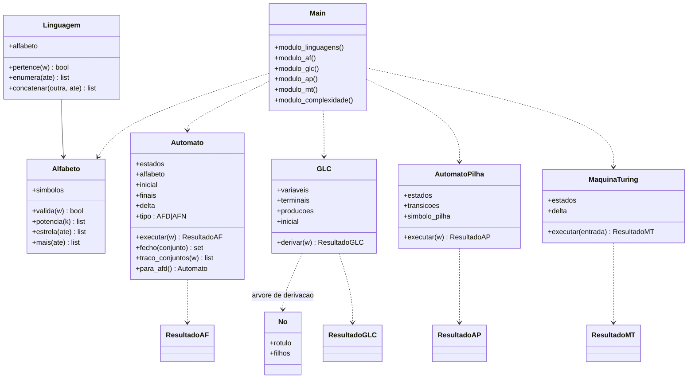

# Simulador de Linguagens Formais e Modelos Computacionais

Projeto prático da disciplina **Aspectos Teóricos da Computação** (AV3).
Aplicação de console em **Python 3.10+** (sem dependências externas) que modela, valida e
simula os principais conceitos da Teoria da Computação:

| Módulo | Conteúdo | Arquivo |
|---|---|---|
| 1 | Linguagens formais: Σ, Σ\*, Σ⁺, tamanho, concatenação, linguagem L | `simulador/linguagens.py` |
| 2 | Autômatos finitos AFD / AFN (com transições λ), carga por JSON, passo a passo, AFN → AFD | `simulador/automato_finito.py` |
| 3 | Gramática livre de contexto: derivação passo a passo e árvore de derivação | `simulador/glc.py` |
| 4 | Autômato com pilha (leitura, estado e pilha a cada passo) | `simulador/automato_pilha.py` |
| 5 | Máquina de Turing: **opção A** (`w#w`) **e opção B** (soma unária) | `simulador/maquina_turing.py` |
| 6 | Complexidade (O, Ω, Θ) + medição empírica de passos | `simulador/complexidade.py` |

**Autores:** _Nome 1_ e _Nome 2_ — Disciplina: Aspectos Teóricos da Computação.

## Como executar

```bash
git clone <URL-DO-REPOSITORIO>
cd simulador_tc

python main.py            # menu interativo
python main.py --demo     # demonstração automática de todos os módulos
python -m unittest discover -s tests -v   # 19 testes automatizados
```

Requer apenas Python 3.10 ou superior (`python --version`). No Windows use `python`; no Linux/macOS, `python3`.

## Estrutura

```
simulador_tc/
├── main.py                  # interface de console (menus)
├── simulador/               # lógica de cada módulo (sem E/S)
│   ├── linguagens.py
│   ├── automato_finito.py
│   ├── glc.py
│   ├── automato_pilha.py
│   ├── maquina_turing.py
│   └── complexidade.py
├── exemplos/                # autômatos e gramáticas em JSON
├── tests/test_simulador.py
└── docs/
```

## Exemplos de entrada e saída

### Módulo 1 – Linguagens formais
```
Σ = {a, b}      Entrada: abba
Cadeia válida para Σ
Tamanho = 4
```
Σ\* (|w| ≤ 2) = `{λ, a, b, aa, ab, ba, bb}`; concatenação `ab · ba = abba`;
`L = (ab)*`: `abab ∈ L`, `aba ∉ L`.

### Módulo 2 – Autômato finito (`exemplos/afd_exemplo.json`)
```
Entrada: ab   (AFD)
  1. q0 --a--> q1
  2. q1 --b--> q2
  q0 -> q1 -> q2
  ACEITA
```
Entrada `aa` → `REJEITA (sem transição de q1 com 'a')`.
O formato JSON está descrito no cabeçalho de `simulador/automato_finito.py`;
`exemplos/afn_exemplo.json` (cadeias que contêm `ab`) e `exemplos/afn_lambda.json`
(aⁿ com n múltiplo de 2 ou de 3, usa transições λ) são AFNs. O menu também converte AFN → AFD.

### Módulo 3 – GLC (`exemplos/glc_anbn.json`: `S -> aSb | λ`)
```
Entrada: aaabbb
S ⇒ aSb ⇒ aaSbb ⇒ aaaSbbb ⇒ aaabbb
S
├── a
├── S
│   ├── a
│   ├── S
│   │   ├── a
│   │   ├── S
│   │   │   └── λ
│   │   └── b
│   └── b
└── b
ACEITA
```
Entrada `aab` → `REJEITA`. Outra gramática pronta: `glc_parenteses.json` (`S -> SS | (S) | λ`).

### Módulo 4 – Autômato com pilha (L = { aⁿbⁿ | n ≥ 1 })
```
Entrada: aabb   (pilha: topo à esquerda, fundo = Z)
Passo Leitura   Restante  Estado  Pilha       Operação
0     (início)  aabb      q0      Z           —
1     lê 'a'    abb       q0      AZ          desempilha Z, empilha AZ
2     lê 'a'    bb        q0      AAZ         desempilha A, empilha AA
3     lê 'b'    b         q1      AZ          desempilha A
4     lê 'b'    λ         q1      Z           desempilha A
5     λ         λ         q2      Z           desempilha Z, empilha Z
ACEITA
```

### Módulo 5 – Máquina de Turing
**Opção A** (`L = { w#w }`, `w ∈ {a,b}*`): `ab#ab` → ACEITA em 18 passos; `ab#ba` → REJEITA.
A fita é mostrada a cada passo com a posição da cabeça (`^`):
```
passo   0 | estado q0       | ab#ab
                              ^
passo   1 | estado pa       | Xb#ab
                               ^
```
**Opção B** (soma unária): `000100` (3 + 2) → fita final `00000`.

### Módulo 6 – Complexidade
A opção 6 do menu imprime a tabela de melhor/médio/pior caso (Ω, Θ, O) de cada algoritmo
e mede o número de passos para entradas crescentes (ex.: MT `w#w`: passos/N² → 0,5 ⇒ Θ(N²)).

## Arquitetura (UML)

Diagrama de classes (renderizado automaticamente pelo GitHub/GitLab):



Casos de uso (ator: **Estudante**): definir alfabeto/linguagem e validar cadeias; carregar autômato por JSON e
executar cadeia; converter AFN → AFD; definir gramática e ver derivação/árvore; executar AP e ver a pilha;
executar Máquina de Turing e ver a fita; consultar a análise de complexidade.

## Decisões de projeto
* **Lógica separada da interface:** `simulador/` não faz `print`/`input`; só `main.py` interage com o usuário.
* **GLC:** busca em largura sobre formas sentenciais (derivação mais à esquerda) com podas por
  prefixo/sufixo de terminais e comprimento mínimo; funciona com λ-produções e recursão à esquerda.
* **AP e AFN:** simulados de forma não determinística por busca em largura sobre configurações.
* **Máquina de Turing:** motor genérico (tabela de transições); sem transição ⇒ rejeita.
